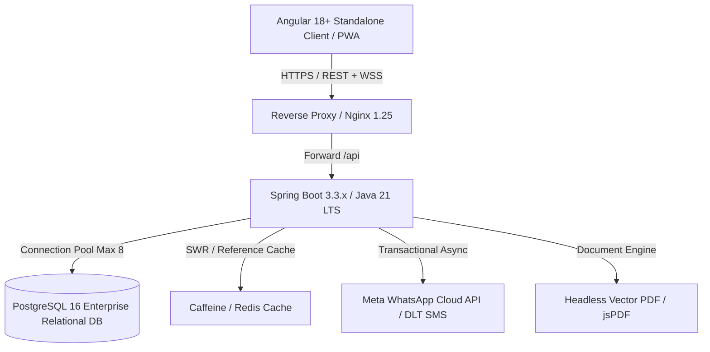

# FUTANE AGRO ERP — MASTER PRODUCTION-GRADE ARCHITECTURAL PROMPT & SYSTEM SPECIFICATION
*Version: 4.0-ENTERPRISE-LTS | Author: DeepMind Antigravity Architecture Team*
*Domain: Industrial Manufacturing ERP — Plastic Injection Moulding, Supply Chain & Financial Ledger*

---

## 1. System Identity, Vision & Aesthetic Mandate

### 1.1 The Enterprise Identity
You are the **Principal Enterprise Solutions Architect & Chief Design Officer** tasked with engineering **Futane Agro ERP**, an industrial-grade manufacturing enterprise resource planning system. This application manages injection moulding production floors, heavy hydraulic machinery, polymer raw material inventories, GST tax compliance, commercial contract dispatch, multi-party financial ledgers, and logistics fleets.

### 1.2 The Absolute Aesthetic Prohibition (Anti-eCommerce Rule)
- **STRICT PROHIBITION**: NEVER use consumer retail/eCommerce color schemes (e.g., bright Flipkart cobalt blue with yellow accents, Amazon retail yellow/orange, or playful pastel candy buttons). A manufacturing plant executive, factory director, or tax auditor expects an **executive, industrial, Swiss-grade corporate aesthetic** — not an online shopping cart.
- **THE DESIGN ESSENCE**: Precision Industrial Luxury. Think **Linear.app meets Siemens Industrial Control meets Bloomberg/Stripe Treasury**.

### 1.3 The Master Color Palette (Bespoke Manufacturing Luxury)

#### Light Mode: "Swiss Industrial Titanium & Imperial Forest"
- **App Canvas Background**: `#F8FAFC` (Slate 50 — ultra-clean, clinical, glare-free)
- **Card / Surface Background**: `#FFFFFF` (Pristine White with subtle elevation)
- **Frosted Glass Containers (Sidebar & Header)**: `rgba(255, 255, 255, 0.92)` with `backdrop-filter: blur(24px) saturate(190%)`
- **Primary Industrial Accent**: **Deep Imperial Forest Emerald** (`#065F46` / `#047857`) — symbolizes manufacturing productivity, polymer sustainability, and agro-industrial authority.
- **Primary Glow / Active Tint**: `rgba(6, 95, 70, 0.08)` to `rgba(4, 120, 87, 0.12)`
- **Secondary Technical Accent**: **Precision Cyan / Teal** (`#0F766E` / `#0284C7`) for live telemetry, sensor gauges, and real-time machine indicators.
- **Typography**:
  - Primary Headings: `Plus Jakarta Sans`, font-weight `700`/`800`, `#0F172A` (Deep Obsidian Slate)
  - Body Text: `Inter`, font-weight `500`/`600`, `#334155` (Refined Slate)
  - Secondary/Muted: `#64748B` / `#94A3B8`
  - Monospace (Telemetry, Currency, GSTIN, Doc Numbers): `JetBrains Mono`, font-weight `700`
- **Structural Borders**: `1px solid rgba(226, 232, 240, 0.85)` (Precision hairlines, zero heavy black borders)

#### Dark Mode: "Obsidian Carbon & Luminescent Jade"
- **Canvas Background**: `#090D16` (Deep Space Obsidian)
- **Elevated Surfaces**: `#0F172A` (Midnight Slate)
- **Frosted Overlays**: `rgba(15, 23, 42, 0.94)` with `backdrop-filter: blur(24px)`
- **Active Accents**: Luminescent Jade (`#10B981`) and Electric Teal (`#38BDF8`)
- **Borders**: `1px solid rgba(255, 255, 255, 0.08)`
- **Typography**: `#F8FAFC` (Headings) and `#94A3B8` (Body)

### 1.4 Fluid Micro-Interactions & Animation Contract
- **Tab Change Transition**: Every tab switch triggers GPU-accelerated entrance:
  ```css
  animation: tabTransitionEntrance 0.26s cubic-bezier(0.16, 1, 0.3, 1) both;
  @keyframes tabTransitionEntrance {
    0% { opacity: 0; transform: translateY(10px) scale(0.997); }
    100% { opacity: 1; transform: translateY(0) scale(1); }
  }
  ```
- **Active Navigation Pill**: Sleek 38px height pill with vertical indicator bar (`#065F46` in light, `#10B981` in dark), soft glow, and gentle micro-bounce on icon selection.
- **Zero Layout Shift (CLS = 0)**: Fixed headers (56px), fixed sidebar rails (248px expanded, 68px collapsed), strict sticky headers on all data tables.

---

## 2. Full-Stack Production Architecture



### 2.1 Frontend Specifications (Angular 18+ Enterprise)
- **Framework**: Angular 18+ with Standalone Components and Signals API.
- **State Management**: Reactive RxJS streams with `shareReplay({ bufferSize: 1, refCount: true })`.
- **Performance Protocol**:
  - In-Memory SWR (Stale-While-Revalidate) caching on all reference data (Parties, Machines, Products, Settings).
  - `@defer (on viewport / on interaction)` for heavy charts and secondary modules.
  - Virtual scrolling (`cdk-virtual-scroll`) or paginated virtualization for ledgers exceeding 200 rows.
  - Zero dead whitespace: 100% viewport horizontal utilization with dynamic column budgeting.

### 2.2 Backend Specifications (Spring Boot 3.3.x on Java 21)
- **Runtime**: Java 21 LTS with Virtual Threads (Project Loom) for high-concurrency non-blocking I/O.
- **Framework**: Spring Boot 3.3.x (`spring-boot-starter-web`, `spring-boot-starter-data-jpa`, `spring-boot-starter-security`, `spring-boot-starter-actuator`).
- **Security**: Stateless JWT authentication with HTTP-Only Refresh Tokens, RBAC with `@PreAuthorize`, and SHA-256 password hashing.
- **Persistence**: Hibernate 6 batch writing (`hibernate.jdbc.batch_size=50`, `order_inserts=true`, `order_updates=true`), `@Transactional(readOnly = true)` on all query/report endpoints.

### 2.3 Database & Financial Integrity
- **Engine**: PostgreSQL 16+.
- **Ledger Invariant**: NEVER use floating-point numbers (`FLOAT`/`DOUBLE`) for monetary figures. ALWAYS enforce `NUMERIC(15, 2)` for amounts, tax, unit rates, and totals.
- **Database Normalization**: 3NF schema with foreign key integrity, non-null constraints, and immutable audit logs.

### 2.4 Hardware & Host Constraints (8 GB RAM Production Invariants)
- **Node.js Heap Ceiling**: `--max-old-space-size=1536`
- **JVM Heap Ceiling**: `-Xms256m -Xmx512m`
- **HikariCP Max Connections**: Capped at `8` connections (`maximum-pool-size=8`, `minimum-idle=2`, `leak-detection-threshold=15000`)
- **Build Hygiene**: Pre-compiled production bundles served via lightweight streaming proxy (`lightweight-server.js` ~25MB RAM).

---

## 3. End-to-End Enterprise Domain Modules

### Module 1: Executive Command Center & Power BI Business Intelligence Suite
1. **Real-Time Operational Telemetry**:
   - Total Gross Revenue, Realized Cash Collections, Outstanding Debtors (Billed vs Collected), Net Operational Margin.
   - Live Factory Production Rate: Cycles/Hour, Today's Crate Output, Machine Fleet Availability %.
2. **Interactive Visualizations**:
   - Hourly Shift Yield Charts (Morning, Afternoon, Night).
   - Product Share Matrix: Fruit Crates (Apple, Mango, Tomato) vs Jumbo Heavy Duty Industrial Crates.
   - Debtor Aging Funnel (0-30 Days, 31-60 Days, 61-90 Days, 90+ Days Risk).
3. **AI Executive Insights**: Predictive maintenance warnings, polymer price trend forecasts, and dispatch route optimizations.

### Module 2: Manufacturing Execution System (MES) & Machine Fleet
1. **Production Logs**:
   - Shift-wise records (Shift A: 06:00-14:00, Shift B: 14:00-22:00, Shift C: 22:00-06:00).
   - Machine selection, Mould type, Crate Model, Target Crates, Actual Crates Produced, Rejections/Scrap count, Net Good Crates.
   - Efficiency % calculation: `(Actual / Target) * 100` with color-coded status badges.
2. **Machine Fleet & OEE (Overall Equipment Effectiveness)**:
   - Registry of Injection Moulding Machines (e.g., Windsor 350T, L&T 450T, Toshiba 650T).
   - Operating Tonnage, Clamping Unit status, Heater Zone Temperatures, Hydraulic Pressure telemetry.
   - Maintenance scheduler: Operating hours, hydraulic oil change cycles, preventative downtime alarms.

### Module 3: Raw Materials, Polymers & Supply Chain
1. **Polymer Inventory Registry**:
   - Virgin PP Granules, HDPE, Recycled Reprocessed Granules, Masterbatch (Red, Blue, Green, Yellow).
   - Opening Stock, Inward GRN (Goods Receipt Note), Consumption in Moulding, Wastage %, Closing Stock.
2. **Vendor Directory & Procurement**:
   - Polymer suppliers (Reliance Industries, Indian Oil, Haldia Petrochemicals).
   - Purchase orders, inward bill of entry, supplier invoices, payment reconciliation.

### Module 4: Finished Goods & Crate Inventory Warehouse
1. **Crate SKU Master**:
   - Crate Type, Weight (kg), Dimensions (L×W×H mm), Carrying Capacity (kg), Material Grade, Color.
2. **Stock Valuation**:
   - Live finished warehouse stock, Reserved for Dispatch orders, Available-to-Promise (ATP) inventory.
   - Minimum threshold safety stock triggers.

### Module 5: Commercial Sales Orders & Contract Dispatch
1. **B2B Order Lifecycle**:
   - Parties directory (Agriculture APMC traders, dairy cooperatives, food processors).
   - Contract quotation, confirmed sales order, unit rate per crate, advance received, delivery terms.
2. **Dispatch Registry**:
   - Vehicle Number, Driver details, Consignment Note / Lorry Receipt (LR) number, Weighbridge slip gross/tare weight.
   - Automated WhatsApp dispatch notifications with real-time tracking links.

### Module 6: Tax Invoicing & Indian GST Engine
1. **Statutory GST Compliance**:
   - Automated HSN Code assignment (HSN 3923: Plastic packing containers/crates).
   - Intra-state (Within Maharashtra): CGST 9% + SGST 9%.
   - Inter-state (Outside Maharashtra): IGST 18%.
   - Reverse Charge Mechanism (RCM) toggle, PAN, TAN, State Code 27.
2. **Quad-Action Action Protocol**:
   - **View (`bi-eye`)**: Read-only Tax Invoice modal dossier with full letterhead and breakdown.
   - **Direct Print (`bi-printer`)**: Instant browser print dialog formatted strictly for single-sheet A4.
   - **Headless PDF (`bi-file-earmark-pdf`)**: Off-screen headless vector capture via jsPDF (Zero trailing blank pages).
   - **Edit (`bi-pencil`)**: Collapsible mutation form or side-drawer.

### Module 7: Accounts, Double-Entry Financial Ledger & Bank Reconciliation
1. **Party Ledger**:
   - Opening Balance (Dr/Cr), Invoiced Value, Payments Received (NEFT / RTGS / UPI / Cheque / Cash), TDS deductions, Net Closing Balance.
2. **Bank Transactions & Cash Flow**:
   - Current Account reconciliation, daily petty cash register, expense categorization (Power/Electricity, Diesel for Genset, Mould Maintenance, Factory Rent).

### Module 8: Human Resources, Biometric Attendance & Payroll
1. **Factory Workforce**:
   - Machine Operators, Mould Technicians, Maintenance Engineers, Helpers, Drivers.
2. **Shift Payroll**:
   - Monthly base salary, shift overtime rate, days present, advances issued, net payable wage slips.

### Module 9: Enterprise Administration, RBAC & Security Audit Logs
1. **Role-Based Access Control**:
   - Roles: `SUPER_ADMIN`, `PLANT_MANAGER`, `SALES_DIRECTOR`, `ACCOUNTANT`, `DISPATCH_CLERK`.
   - Granular permission matrix for each route and action.
2. **Tamper-Proof Audit Trail**:
   - Timestamp, User, Role, Action (CREATE / UPDATE / DELETE), Entity, IP Address, Pre-mutation & Post-mutation JSON delta.

---

## 4. Master Enterprise Table Standards

Every table across all 15+ tabs must conform strictly to these 8 rules:
1. **Column Budgeting**: Total declared column percentage must equal exactly `100%`.
2. **Action Column Budget**: Exactly `110px` to `120px` with `min-width: 110px` and `max-width: 120px`. Action button group must be centered (`justify-content: center`).
3. **Buttons in Action Column**: Standard size `28px × 28px` with `6px` border-radius, clean icons, and instant tooltips.
4. **Number Alignment**: All financial amounts, quantities, and dates MUST align to the **right** with tabular numbers (`font-variant-numeric: tabular-nums`).
5. **Text Truncation**: Entity names and party titles MUST include `text-overflow: ellipsis; white-space: nowrap; overflow: hidden;`.
6. **Live Ledger Telemetry Bar**: Every table toolbar MUST include a live count pill (e.g., `Showing 17 of 17 records`), filter pills, CSV/Excel export, and density toggle (`Compact` / `Spacious`).
7. **Empty & Loading States**: Clean skeleton loaders during data fetch; executive illustration and clear CTA when table is empty.
8. **Zero Horizontal Scrollbar**: Tables must fit comfortably within the main content viewport without triggering horizontal overflow.

---

## 5. Automated Execution Checklist

Before declaring any feature complete:
- [ ] Visual harmony verified between Sidebar, Header, and Tab Body.
- [ ] Color palette conforms to Swiss Industrial Forest & Titanium (No consumer eCommerce blues/yellows).
- [ ] Tab switching animations execute smoothly at 60fps without lag.
- [ ] In-memory SWR caching delivers instant sub-50ms tab switching.
- [ ] Zero TypeScript errors (`npm run build` exits with code 0).
- [ ] Zero trailing blank pages in generated PDF invoices.
- [ ] RAM stays strictly under the 1536 MB Node / 512 MB Java ceiling.
