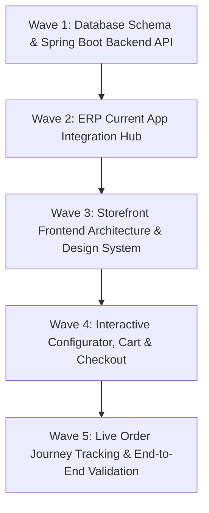

# FUTANE AGRO STOREFRONT — MASTER ARCHITECTURAL PROMPT & SYSTEM SPECIFICATION
*Document Version: 1.0-LTS | Author: Principal Enterprise Architecture & UX Engineering*
*Project: High-Profile Customer Ordering Web Application ("Futane Direct") & ERP Synchronization Bridge*

---

## 1. Executive Mission & System Vision

### 1.1 The Objective
Build a world-class, **high-profile consumer-grade customer ordering web application** for **Futane Agro** (comparable in visual punch, fluid responsiveness, and ordering delight to platforms like **Burger King**, **Domino's**, **Apple**, and **Nike**), coupled with an automated bidirectional integration into the existing **Futane Agro ERP** (Spring Boot 2.7+ / MySQL 8 / Angular 17+).

### 1.2 The Strategic Separation of Concerns
1. **The Customer Storefront ("Futane Direct / Storefront")**:
   - High-energy, visually captivating, lightning-fast web application tailored for farmers, commercial agro-traders, cold chain exporters, and wholesale distributors.
   - Focus: Appetizing visual hierarchy, dynamic interactive product configurator, live truckload volume calculator, instant mobile/WhatsApp checkout, and live order tracking ("Crate Journey Tracker").
2. **The ERP Integration Bridge (Current App Updates)**:
   - Extends the core Spring Boot backend and Angular ERP.
   - Seamlessly receives incoming storefront orders, checks/reserves inventory in `t_inv_inventory`, links or registers buyers into `t_sal_parties`, alerts factory operators via WebSockets, and bridges approved orders directly into `t_sal_sales` and `t_tra_dispatches`.

---

## 2. Design Language: "Burger King Grade" Visual Aesthetics

### 2.1 Aesthetic Philosophy
The storefront must completely shatter the perception of boring B2B agricultural equipment. It must feel **premium, ultra-modern, tactile, and exhilarating**:

- **Vibrant, Curated Brand Palette**:
  - *Primary Harvest Amber*: `#D97706` / `#F59E0B` (Futane Agro signature gold-amber).
  - *Industrial Forest Emerald*: `#065F46` / `#059669` (Agricultural vitality, premium polymer durability).
  - *Obsidian Charcoal*: `#0F172A` / `#090D16` (High-contrast typography, premium dark elements).
  - *Frosted Glass & Depth*: Glassmorphic surfaces (`backdrop-filter: blur(20px)`), luminous neon badge accents, and subtle gradient glows.
- **Micro-Interactions & Motion**:
  - Parallax hero banners showcasing high-definition agricultural crates with dynamic floating particle effects.
  - Interactive product cards that elevate on hover with realistic drop shadows and subtle 3D tilt.
  - Animated "Add to Cart" micro-feedback (subtle bounce, button morphing into quantity counter).
  - Sticky bottom order bar on mobile devices that glides into view when an item is added.

---

## 3. Customer Website ("Futane Direct") Feature Matrix

### 3.1 Hero & Category Navigation
1. **Dynamic Hero Showcase**:
   - Bold headline: *"Engineered for Bumper Harvests. Delivered in Record Time."*
   - Interactive call-to-action buttons: *"Explore Crates"* & *"Quick Bulk Order (500+ Crates)"*.
   - Live social proof counter: *Over 2,50,000+ Crates Deployed Across Maharashtra, Gujarat & Karnataka*.
2. **Sticky Category Filter Rail**:
   - Quick-filter chips with iconography:
     - 🍇 *Grape Export Crates* (Perforated Food-Grade)
     - 🍅 *Tomato Commercial Trays* (Heavy-Duty HDPE)
     - 🥭 *Mango Export Boxes* (Solid & Ventilated)
     - 🍊 *Citrus & Pomegranate Crates* (Shock-Absorbing)
     - 🥦 *Exotic Vegetables & Cold Storage Trays*
     - 🛠️ *Custom Molded & Color Coded Crates*

### 3.2 High-Profile Product Cards & Interactive Configurator
1. **Interactive Product Cards**:
   - High-definition crate visuals with dynamic color switcher (Agro Green, Royal Blue, Industrial Red, Sun Yellow).
   - Capacity & Specs Pill Badges: e.g., `Load: 25 KG`, `Stacking: 8 High`, `100% Virgin HDPE`, `Food Grade Certified`.
   - Tiered Wholesale Price Badges (Real-time dynamic unit price adjustment based on quantity slider: 50–200 units, 201–1,000 units, 1,000+ units).
2. **Burger King-Style Customization Drawer**:
   - Opens when the buyer clicks *"Customize & Order"*:
     - **Select Material Grade**: Virgin HDPE (Export Grade) vs Reprocessed Polymer (Budget Field Crate).
     - **Embossing / Stamping**: Add custom company name/logo stamping (preview rendered live on 3D crate mock).
     - **Ventilation Style**: Fully Perforated, Semi-Vented, or Solid Base.
     - **Truckload Estimator**: Real-time progress bar showing capacity filled for a Mini Truck (Tata Ace: 300 crates), Medium (Eicher 14ft: 1,200 crates), or Full Multi-Axle Truck (3,500 crates).

### 3.3 Seamless Cart & 1-Tap Checkout Experience
1. **Slide-Out Floating Cart Drawer**:
   - Itemized summary with quantity +/- steppers.
   - Live GST (18%) breakdown (`CGST 9% + SGST 9%`).
   - Truckload volume efficiency meter (prompts: *"Add 80 more crates to optimize your freight rate!"*).
2. **Frictionless Checkout**:
   - **Fast Auth**: Single-step Mobile Number OTP or WhatsApp verification (no tedious 10-field registration forms).
   - **GSTIN Auto-Fill**: Enter GST number, automatically fetches Party Name and Registered Tax Address via API.
   - **Delivery Address & Pin Code Selection**: Delivery distance and freight freight calculation.
   - **Flexible Payment Options**:
     - *Online Payment*: UPI, NetBanking, Credit/Debit Cards (Razorpay/Cashfree integration).
     - *Advance + Delivery*: 25% Advance Online + 75% on Delivery.
     - *Credit Terms (Approved ERP Parties)*: 30-Day Credit Account for pre-approved parties in `t_sal_parties`.

### 3.4 The "Burger King Style" Live Crate Journey Tracker
A dedicated order tracking interface (`/track-order/:orderId`):
1. **Visual Stage Stepper with Animations**:
   - 🟡 **Order Received & Verified**: ERP system verified stock / order confirmed.
   - 🔵 **Moulding & Quality Testing**: Factory injection moulding / quality batch audit.
   - 🟠 **Packed & Invoiced**: GST Tax Invoice generated, crates palletized.
   - 🚚 **Dispatched on Fleet**: Truck number, driver name, mobile number, and dispatch manifest linked.
   - 🟢 **Delivered**: Customer sign-off & challan uploaded.
2. **Instant Actions**:
   - Download Official GST Tax Invoice PDF.
   - WhatsApp Support / Direct Call to Dispatch Supervisor.
   - "Reorder Same Batch in 1-Click".

---

## 4. Backend Architecture & Database Extensions (Current App)

### 4.1 New Database Tables (MySQL 8 / Spring Boot JPA)

```sql
-- 1. Web Customers / Portal Users
CREATE TABLE t_cus_portal_users (
    id BIGINT AUTO_INCREMENT PRIMARY KEY,
    mobile VARCHAR(15) NOT NULL UNIQUE,
    full_name VARCHAR(150),
    email VARCHAR(150),
    company_name VARCHAR(200),
    gst_number VARCHAR(20),
    address TEXT,
    city VARCHAR(100),
    state VARCHAR(100),
    pincode VARCHAR(10),
    linked_party_id BIGINT NULL,
    is_active BOOLEAN DEFAULT TRUE,
    created_at TIMESTAMP DEFAULT CURRENT_TIMESTAMP,
    CONSTRAINT fk_portal_user_party FOREIGN KEY (linked_party_id) REFERENCES t_sal_parties(id)
);

-- 2. Customer Web Orders
CREATE TABLE t_ord_customer_orders (
    id BIGINT AUTO_INCREMENT PRIMARY KEY,
    order_number VARCHAR(50) NOT NULL UNIQUE,
    customer_id BIGINT NOT NULL,
    total_items INT NOT NULL,
    subtotal DECIMAL(12, 2) NOT NULL,
    gst_rate DECIMAL(5, 2) DEFAULT 18.00,
    cgst DECIMAL(12, 2) NOT NULL,
    sgst DECIMAL(12, 2) NOT NULL,
    freight_charges DECIMAL(12, 2) DEFAULT 0.00,
    grand_total DECIMAL(12, 2) NOT NULL,
    payment_method VARCHAR(50) NOT NULL, -- 'ONLINE_FULL', 'ADVANCE_25', 'CREDIT_ACCOUNT'
    payment_status VARCHAR(50) DEFAULT 'PENDING', -- 'PENDING', 'PAID', 'PARTIALLY_PAID'
    order_status VARCHAR(50) DEFAULT 'NEW_ORDER', -- 'NEW_ORDER', 'APPROVED', 'IN_PRODUCTION', 'PACKED', 'DISPATCHED', 'DELIVERED', 'CANCELLED'
    delivery_address TEXT NOT NULL,
    delivery_city VARCHAR(100),
    delivery_state VARCHAR(100),
    delivery_pincode VARCHAR(10),
    expected_delivery_date DATE,
    erp_sale_id BIGINT NULL,
    erp_dispatch_id BIGINT NULL,
    notes TEXT,
    created_at TIMESTAMP DEFAULT CURRENT_TIMESTAMP,
    updated_at TIMESTAMP DEFAULT CURRENT_TIMESTAMP ON UPDATE CURRENT_TIMESTAMP,
    CONSTRAINT fk_order_customer FOREIGN KEY (customer_id) REFERENCES t_cus_portal_users(id),
    CONSTRAINT fk_order_sale FOREIGN KEY (erp_sale_id) REFERENCES t_sal_sales(id),
    CONSTRAINT fk_order_dispatch FOREIGN KEY (erp_dispatch_id) REFERENCES t_tra_dispatches(id)
);

-- 3. Customer Order Items
CREATE TABLE t_ord_order_items (
    id BIGINT AUTO_INCREMENT PRIMARY KEY,
    order_id BIGINT NOT NULL,
    crate_type VARCHAR(150) NOT NULL,
    material_type VARCHAR(100) NOT NULL,
    color VARCHAR(50) DEFAULT 'Green',
    embossing_text VARCHAR(100),
    quantity INT NOT NULL,
    unit_price DECIMAL(10, 2) NOT NULL,
    gross_amount DECIMAL(12, 2) NOT NULL,
    inventory_id BIGINT NULL,
    CONSTRAINT fk_order_item_order FOREIGN KEY (order_id) REFERENCES t_ord_customer_orders(id),
    CONSTRAINT fk_order_item_inv FOREIGN KEY (inventory_id) REFERENCES t_inv_inventory(id)
);

-- 4. Order Live Journey Events (Audit & Tracking Stepper)
CREATE TABLE t_ord_tracking_events (
    id BIGINT AUTO_INCREMENT PRIMARY KEY,
    order_id BIGINT NOT NULL,
    status_step VARCHAR(50) NOT NULL,
    title VARCHAR(150) NOT NULL,
    description TEXT,
    driver_name VARCHAR(100),
    driver_mobile VARCHAR(20),
    vehicle_number VARCHAR(50),
    timestamp TIMESTAMP DEFAULT CURRENT_TIMESTAMP,
    CONSTRAINT fk_tracking_order FOREIGN KEY (order_id) REFERENCES t_ord_customer_orders(id)
);
```

### 4.2 REST API Surface for Customer Storefront (`/api/v1/storefront`)
- `GET /api/v1/storefront/catalog` — Returns available crate products, live inventory availability, images, specifications, and tiered pricing.
- `POST /api/v1/storefront/auth/send-otp` & `verify-otp` — Frictionless mobile OTP authentication.
- `POST /api/v1/storefront/orders` — Submits customer order, computes strict GST, validates minimum volume, reserves inventory.
- `GET /api/v1/storefront/orders/:orderNumber` — Retrieves order status, invoice download token, and live tracking stepper events.
- `GET /api/v1/storefront/customer/orders` — Customer order history and 1-click reorder payloads.

---

## 5. ERP Current App Integration: "Web Orders & Storefront Hub"

### 5.1 New ERP Interface Module: `Web Orders`
Within the existing Angular ERP under the `Commerce` / `Sales` feature grouping:
1. **Live Web Order Feed**:
   - Real-time notification badge on top bar (`🔔 3 New Web Orders`).
   - Dedicated table view with tabs: `All`, `Pending Approval`, `In Production`, `Ready to Dispatch`, `Completed`.
2. **The 1-Click Operational Action Engine**:
   - **`[Approve & Reserve Stock]`**: Verifies `t_inv_inventory`. If stock is sufficient, transitions status and locks quantity. If insufficient, automatically generates production request in `PPD`.
   - **`[Generate ERP Sale & Tax Invoice]`**: Automatically converts `CustomerOrder` into a formal `Sales` record (`t_sal_sales`) and `Invoice` (`t_sal_invoices`) with zero manual re-entry.
   - **`[Dispatch Fleet]`**: Prompts operator to assign a `Driver` and `Transport` vehicle from the existing masters, generating a formal `Dispatch` record and emitting a push event to the customer's live tracker!

---

## 6. Host Hardware & Performance Mandates (Strict 8 GB RAM Rules)

The host machine is a **Windows 11 laptop with only 8 GB of total RAM**. All components must adhere strictly to repository performance invariants:
1. **Frontend Architecture**:
   - Lightweight, standalone architecture (Vite + React or Angular Standalone with Tailwind CSS).
   - Zero bulky dependencies; pre-bundled production assets.
2. **Backend Architecture**:
   - Java Spring Boot heap constrained to `-Xms256m -Xmx512m`.
   - HikariCP database pool capped at `8` connections.
   - Use `@Transactional(readOnly = true)` for all storefront catalog and read queries.
   - Enable GZIP compression on catalog and tracking payloads.
3. **Asset Optimization**:
   - All crate visual assets compressed to modern WebP format under 100 KB each.
   - Zero layout shifts (CLS = 0) and sub-second Largest Contentful Paint (LCP < 1.2s).

---

## 7. Implementation Roadmap & Execution Waves



- **Wave 1 (Backend Core)**: Create entities (`CustomerOrder`, `OrderItem`, `TrackingEvent`, `PortalUser`), DTOs, repositories, services, and public `/api/v1/storefront/*` endpoints.
- **Wave 2 (ERP Bridge)**: Implement the "Web Orders" dashboard tab in the current Angular ERP with live notifications, approve/dispatch actions, and auto-conversion to Sales & Invoices.
- **Wave 3 (Customer Web App Foundation)**: Build the storefront web application with Burger King-grade visual styling, responsive design, hero section, and dynamic crate catalog.
- **Wave 4 (Configurator, Cart & Checkout)**: Implement interactive crate color/stamping customizer, volume price slider, truckload calculator, and OTP/GSTIN checkout.
- **Wave 5 (Live Tracking & Empirical Proof)**: Build the live order journey stepper, connect WebSocket/polling updates, test end-to-end order placement to ERP dispatch, and verify zero RAM degradation.
