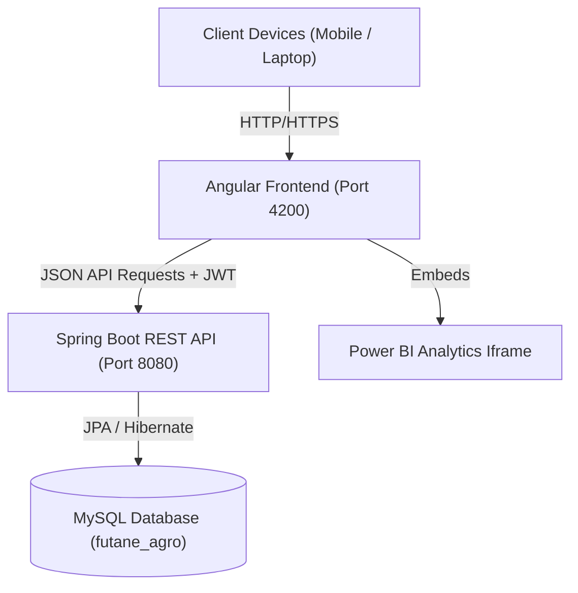

# 📘 Futane Agro Industries Pvt. Ltd. - Enterprise Resource Planning (ERP) System
## Standard Operating Procedure (SOP) & Client Presentation Manual

This document serves as the official Standard Operating Procedure (SOP) and presentation-ready manual for the **Futane Agro ERP Application**. It outlines the system architecture, step-by-step user workflows for each module, the exact data import formats (Excel templates), security protocols, and talking points for client presentations.

---

## 🏛 1. System Architecture & Technology Stack

The Futane Agro ERP is built on a modern, secure, and scalable multi-tier enterprise architecture.



### Core Technologies:
1. **Frontend**: Angular (v17+), standalone components, reactive forms, RxJS, and Chart.js for responsive visual representations.
2. **Backend**: Spring Boot, Java 8, Maven, Spring Security (JWT-based session authentication, failed login lockouts), and Spring Data JPA.
3. **Database**: MySQL, storing encrypted columns (Aadhaar, PAN, Bank account info) transparently using AES-256 encryption.
4. **Hosting & Exposing**: Dynamic API url resolution with `localtunnel` port-forwarding for zero-cost remote/mobile access.

---

## 📂 2. Database Schema & ER Model Reference

The relational database model consists of interconnected tables, built for soft-deleting and auditable transactions.

* **User**: ID, Username, Password (BCrypt hash), Role (ADMIN, MANAGER, ACCOUNTANT, OPERATOR), Active status, Login attempts, Lock expiration.
* **Party**: Customer ID, Name, Address, Contact, Email, City, State, GSTIN, and paths to documents (PAN, Agreement, GST).
* **Vendor**: Supplier ID, Name, Contact, Address, GSTIN.
* **Raw_Material**: Material ID, Date, Name (e.g. HDPE Granules), Vendor ID, Weight, Rate, calculated Amount, and bill document paths.
* **Inventory**: Crate Type (e.g., Apple Crate), Material Type (Plastic), Opening Stock, Produced Stock, Sold Stock, and Current Stock.
* **Ppd (Daily Production)**: Production ID, Date, Crate Type, Total Production, Successful, Rejected, Shift (Morning/Night).
* **Ppm (Monthly Summary)**: Summary ID, Month, Year, Crates Produced, Electricity Units, Electricity Bill.
* **Sales**: Invoice ID, Date, Customer Party ID, Crate Type, Crate Material, Quantity, Rate, calculated Total Amount, Paid, Remaining balance, HSN Code, GST Rate, CGST, SGST, paths to Invoice PDF and Delivery Challan.
* **Payment_Collection**: Receipt ID, Party ID, Invoice Number, Amount Received, Payment Mode (UPI, Cash, Bank), Payment Date.
* **Transport**: Log ID, Date, Truck Number, Driver ID, Rent, Advance paid.
* **Driver**: Driver ID, Name, Mobile, License Number, Address.
* **Employee**: Employee ID, Name, Contact, Base Salary, Address, Designation, Joining Date, encrypted Aadhaar Number, encrypted Bank Account.
* **Employee_Salary**: Slip ID, Employee ID, Month, Year, Salary Amount, Status (Paid/Pending), Paid Date.
* **Machine_Master**: Machine ID, Name, Code, Installed Date, Status (Running/Down), Capacity Per Hour.
* **Machine_Breakdown**: Breakdown ID, Machine ID, Date, Description, Resolved Date, Downtime Hours.
* **Dispatch**: Dispatch ID, Sale Invoice ID, Date, Vehicle Number, Driver Name, Delivery Address, Status (Pending/Delivered).
* **Expense**: Expense ID, Date, Category (Maintenance, Utilities, Tea/Snacks, Miscellaneous), Description, Amount, Paid By (Username).
* **Bank_Transaction**: Transaction ID, Date, Type (Credit/Debit), Amount, Description, Reference/UPI Number.
* **Audit_Log**: Log ID, Username, Action, Timestamp, Table Name, Old Value, New Value.

---

## 📑 3. Step-by-Step Module Operations (SOP)

This section details how operators, accountants, and managers perform daily operations in the ERP.

### 3.1. Authentication & Session Security
1. Navigate to the portal URL (local or public tunnel).
2. Enter your assigned **Username** and **Password** (e.g. `admin` / `admin123`).
3. If valid, the system advances to the **OTP Verification Screen** and generates a 6-digit OTP (for development, the OTP is printed in a green box on screen; in production, this integrates with SMS gateway).
4. Enter the OTP before the **120-second timer** expires.
5. Click **Verify OTP**.
6. *Security Note*: Entering the incorrect password 5 times locks the account automatically for 30 minutes to prevent brute-force attacks.

### 3.2. Dashboard & Financial Control
* **P&L Metrics**: The dashboard aggregates current live data:
  * **Total Income**: Auto-calculated from all Sales invoices.
  * **Total Expenses**: Auto-calculated from: `Raw Materials Cost` + `Transport Rent` + `Released Employee Salaries` + `Logged Expenses`.
  * **Net Profit**: Displayed dynamically. Green background if profitable, red if in a net loss.
* **Visual Charts**: Interactive graphs show Production summaries (bar chart), Sales growth trends (line chart), and Top Customers revenue contributions (pie chart).
* **Language Switcher**: Click **EN**, **मराठी**, or **हिंदी** at the top right. The entire sidebar menu, dashboard headers, stats cards, and descriptions dynamically translate.
* **API Config**: The header displays the active API Endpoint (e.g., `http://localhost:8080/api`). If hosting via tunnel, operators can paste the public backend API URL directly into this box to route traffic.

### 3.3. Daily Production Entry (Operators)
1. Navigate to **Production** (⚙️).
2. Enter the Date, select the Crate Type (e.g., Apple Crate, Tomato Crate, Mango Crate).
3. Select the Shift (Morning Shift / Night Shift).
4. Input **Successful Crates** and **Rejected Crates**.
5. Click **Save**.
6. *Business Rules*:
  * The system will block saving if the rejected count is greater than the total production.
  * Successful crates are automatically added to the matching item in **Inventory Stock** immediately.

### 3.4. Commercial Sales & PDF Invoice Generation
1. Navigate to **Sales** (💼).
2. Select the Customer Party from the dropdown list.
3. Input the Crate Type, Crate Material, Quantity, and Sales Rate (per crate).
4. The system automatically calculates the **Total Amount** in real-time.
5. Input the **Paid Amount** (can be full payment, partial, or 0 for credit).
6. Click **Save**.
7. *Automatic Actions*:
  * Inventory stock is immediately reduced by the sold quantity.
  * A sequential invoice number is created.
  * Go to **Invoices** (🧾) tab. Click **View Invoice** to inspect the billing. Click **Download PDF** to export a clean, A4-print-friendly commercial invoice containing corporate logo, GST calculations (9% CGST + 9% SGST), bank details, and dynamic QR Code.

### 3.5. Employee Registry & Payroll (HR)
1. Go to **HR & Payroll** (👔) to register employees (Name, Aadhaar, Bank Account, base salary).
2. *Security Note*: Employee Aadhaar and Bank Accounts are encrypted in the database using AES-256, protecting sensitive personal data.
3. To disburse salary, go to **Salaries** (💵), choose the employee, specify the month/year, and click **Save**. Released salaries are automatically logged as factory expenses in the P&L dashboard.

---

## 📊 4. Excel Import Template Structure

The system supports importing data in bulk via Excel spreadsheets. The uploaded file MUST contain sheets with the exact names and column structures specified below.

### 4.1. Sheet 1: `Party`
This sheet is used to upload customer details.

* **Sheet Name**: `Party` (case-insensitive)
* **Header Row**: Column headers must exist in Row 1.
* **Columns**:
  * **Column A (Party ID)**: Integer, unique identifier (e.g. `101`, `102`).
  * **Column B (Party Name)**: Text, name of the company or customer.
  * **Column C (Party Address)**: Text, full address.
  * **Column D (Party Contact)**: Text/Numeric, mobile or landline number.

**Example Table Layout**:
| Party ID | Party Name | Party Address | Party Contact |
| :---: | :--- | :--- | :--- |
| 1001 | Maruti Distributors | Gate 5, Hadapsar Industrial Area, Pune | 9876543210 |
| 1002 | Sai Fruits Pvt. Ltd. | Shop 44, APMC Market, Vashi, Navi Mumbai | 9223344556 |

---

### 4.2. Sheet 2: `Inventory`
This sheet is used to initialize or adjust opening stock balances.

* **Sheet Name**: `Inventory` (case-insensitive)
* **Header Row**: Column headers must exist in Row 1.
* **Columns**:
  * **Column A (Crate Type)**: Text, name of the crate type (e.g. `Apple Crate`, `Tomato Crate`, `Mango Crate`).
  * **Column B (Material Type)**: Text, plastic material (e.g. `Plastic`, `HDPE`).
  * **Column C (Opening Stock)**: Integer, initial count available in the warehouse.

**Example Table Layout**:
| Crate Type | Material Type | Opening Stock |
| :--- | :--- | :---: |
| Apple Crate | Plastic | 5000 |
| Tomato Crate | Plastic | 3500 |
| Mango Crate | HDPE | 1200 |

---

## 🎤 5. Client Presentation & Demonstration Guide

Use these talking points and demo sequences during a client pitch or executive review.

### 5.1. Key Value Propositions (Pitch Highlights)
1. **P&L Transparency**: Show how the dashboard automatically links purchases, production rejections, logistics, and employee salaries to calculate the exact Net Profit of the business in real-time.
2. **Dynamic Multi-Language Support**: Demonstrate switching between English, Marathi, and Hindi with a single click. Ideal for local operators, loaders, and drivers who prefer Marathi/Hindi interfaces.
3. **Double-Layer Data Security**:
   * **Session Security**: Two-Factor Authentication via OTP and automatic account lockouts protect the ERP from unauthorized outside access.
   * **Database Privacy**: AES-256 column-level encryption shields employee personal details (Aadhaar, Bank Accounts) from data breaches.
4. **Cloud Accessibility via Local Tunnels**: Show how the owner can access the ERP on their mobile phone or home laptop while the servers are running on the factory office computer—with zero cloud hosting expenses.
5. **Print-Friendly Invoice PDF**: Show the commercial invoice with logo, GST tax details, and QR codes ready for immediate customer sharing via WhatsApp or email.

### 5.2. Recommended Demo Sequence
```text
1. Open Login Page ➔ Type 'admin'/'admin123' ➔ View OTP timer ➔ Verify OTP.
2. View Dashboard ➔ Highlight the P&L cards ➔ Switch language to मराठी/हिंदी to show translations.
3. Go to Production ➔ Log a mock entry ➔ Show how Inventory stock increases immediately.
4. Go to Sales ➔ Log a customer sale (partial payment) ➔ Show stock reduction and remaining balance.
5. Go to Invoices ➔ Open the PDF modal ➔ Download the generated PDF invoice.
6. Go to Audit Logs ➔ Show how the system recorded the login, production entry, and sale.
```

---

## 📱 6. Mobile & Remote Laptop Setup Instructions

To access the ERP on any device (phone, tablet, remote laptop) for testing and presentation:

1. **Connect & Launch Tunnels**:
   * Double-click the `expose-servers.ps1` script in the root directory.
   * Two terminal windows will open, running `localtunnel` for ports `4200` (frontend) and `8080` (backend).
2. **Get Public URLs**:
   * Copy the public URL generated in the Frontend window (e.g., `https://xxxx-xxxx.loca.lt`).
   * Copy the public URL generated in the Backend window (e.g., `https://yyyy-yyyy.loca.lt`).
3. **Open Frontend on Mobile**:
   * Open Chrome/Safari on your mobile phone and navigate to the Frontend URL.
   * If localtunnel displays a warning page, click **Click to Continue**.
4. **Link Backend API**:
   * Once the login screen displays, enter credentials and verify OTP.
   * Look at the **API** input box in the top header. Paste your Backend tunnel URL followed by `/api` (e.g., `https://yyyy-yyyy.loca.lt/api`) and press Enter.
   * The page will reload, and the mobile device is now fully linked to the backend! You can perform CRUD, download PDFs, view graphs, and test fully from your mobile phone!
